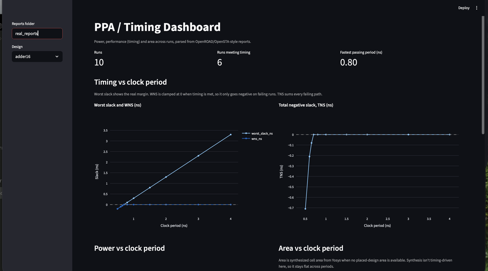

# PPA / Timing Dashboard

A small Python tool that parses static timing, power, and area reports from open-source EDA runs into a pandas DataFrame, then charts how timing, power, and area change across runs (for example, as the clock period is swept).



*The dashboard on real OpenSTA reports from a clock-period sweep (0.5 to 4.0 ns) of a synthesized 16-bit registered adder.*

## PPA and STA in a nutshell

PPA stands for power, performance, and area, the three things chip designers trade against each other. Performance is mostly timing: how fast the clock can run before signals stop arriving in time. Static timing analysis (STA) checks this without simulation. It adds up the cell delays along every path between flip-flops and compares the arrival time with the time the capturing flip-flop needs. The difference is the slack: positive means the path meets timing, negative means it fails. WNS (worst negative slack) is the single worst path, and TNS (total negative slack) is the sum of all failing slacks, so it shows how widespread the failures are. Speeding up the clock shrinks the setup deadline, which pushes slack down and dynamic power up, so timing, power, and area have to be read together.

## What it does

- Parses WNS, TNS, worst slack, worst-path start and end points, total/dynamic/leakage power, area, and utilization from report text.
- Builds one DataFrame row per run, with extra columns such as `timing_met` and `est_fmax_mhz`, and exports it to CSV.
- Shows the results in a Streamlit dashboard: timing vs clock period, TNS, power, area, and a table of all runs.

Design rules:

- **Parse what the tool reports; don't recompute it.** Slack, WNS, and TNS come straight from the report text.
- **Missing values are `NaN`, not zero.** A run without a power report doesn't claim 0 mW.
- **WNS is clamped at 0 when timing is met.** The parser keeps worst slack as a separate column so the real margin stays visible.
- **A printed `-0.00` counts as a failing run.** It means a small negative slack rounded to zero.

## Quick start

Requires Python 3.9+.

```bash
pip install -r requirements.txt
python3 -m pytest                                   # 23 tests
python3 -m ppa_parser real_reports -o results.csv   # parse reports, print a table, write a CSV
streamlit run app.py                                # dashboard (set the sidebar folder to real_reports)
```

## Data

| Folder | Contents |
|---|---|
| `real_reports/` | Real OpenSTA output (timing and power) with Yosys cell area appended, from the sweep below. Files are named `<design>_clk<period>.rpt`; the parser reads the design and clock period from the filename. |
| `sample_reports/` | **Hand-written sample reports** in the same layout, used for early parser development. Each file says so in its header, and the dashboard shows a banner when it loads them. |

### How the real reports were made

`flow_opensta/` holds a 16-bit registered adder (`design.v`), an OpenSTA script (`run.tcl`), and `sweep.sh`. The script synthesizes the design with Yosys against the Nangate45 typical-corner Liberty file, then runs OpenSTA at each clock period and saves one report per run.

```bash
# inside a Linux environment with yosys and OpenSTA built
LIB=<path to NangateOpenCellLibrary_typical.lib> ./sweep.sh 0.5 0.6 0.65 0.7 0.8 1.0 1.5 2.0 3.0 4.0
```

I built OpenSTA in an Ubuntu 22.04 Docker container (aarch64). It needs CUDD, which I built from source (`git checkout 3.0.0`, `autoreconf -fi`, `./configure --prefix=...`, `make install`), then `cmake .. -DCUDD_DIR=...` for OpenSTA, plus `libfmt-dev` and the usual build tools. See the [OpenSTA README](https://github.com/parallaxsw/OpenSTA) for current instructions.

## Results from the adder sweep

| Clock period (ns) | Worst slack (ns) | TNS (ns) | Total power (mW) |
|---|---|---|---|
| 0.5 | -0.20 | -0.71 | 0.608 |
| 0.6 | -0.10 | -0.21 | 0.508 |
| 0.65 | -0.05 | -0.08 | 0.469 |
| 0.7 | -0.00 | -0.00 | 0.436 |
| 0.8 | 0.10 | 0.00 | 0.382 |
| 1.0 | 0.30 | 0.00 | 0.307 |
| 1.5 | 0.80 | 0.00 | 0.207 |
| 2.0 | 1.30 | 0.00 | 0.157 |
| 3.0 | 2.30 | 0.00 | 0.106 |
| 4.0 | 3.30 | 0.00 | 0.081 |

What the numbers show:

- **The critical path is fixed; the deadline moves.** The worst path is the same flop-to-flop adder path in every run (about 0.66 ns plus 0.04 ns setup time), so the design closes timing at roughly 0.70 ns. Slack rises linearly with clock period because only the required time changes. The 0.70 ns run prints `-0.00`, so it fails by a few picoseconds, and the first clean pass is 0.80 ns.
- **Dynamic power scales with clock speed; leakage doesn't.** Total power rises from 0.08 mW at 4.0 ns to 0.61 mW at 0.5 ns, while leakage stays flat at about 0.0059 mW.
- **Area is flat** (305.4 um^2 of synthesized cell area) because synthesis ran once for the whole sweep.

## Limitations

- **One library corner.** Everything uses the Nangate45 typical library. Real signoff checks slow corners for setup and fast corners for hold.
- **Setup only.** The sweep reports maximum-delay (setup) paths. Hold analysis is not covered yet.
- **Ideal clock.** There is no clock tree, so clock-network power shows as zero.
- **Power uses default switching activity.** No simulation activity file (VCD/SAIF) is supplied.
- **Area is synthesized cell area** from Yosys, not placed-and-routed area. The parser records the source in an `area_source` column and also reads OpenROAD's `report_design_area` format.
- **No place-and-route run.** I tried the full OpenROAD-flow-scripts Docker build first, but it failed on my machine with a Qt compile error, so I switched to Yosys plus OpenSTA. The OpenROAD report format is parsed from public examples, not from my own runs.
- **Small design.** A 16-bit adder is a toy; the point is the data pipeline, not the design.

## Roadmap

- Sweep more variables automatically (utilization, synthesis effort, other designs) and collect every run into one table.
- Parse OpenROAD flow reports from real place-and-route runs.
- Add hold analysis and multi-corner support.
- Flag regressions between runs (a run that gets worse than the previous best).
- Correlate timing with power and area across runs, for example slack gained per mW spent.
- Parse worst-path details (start and end points, cell types) across runs.

## Project layout

```
app.py                 Streamlit dashboard
ppa_parser/            parser, CLI, and dashboard helpers
tests/                 pytest tests, including a fixture of real OpenSTA output
real_reports/          reports from the real OpenSTA/Yosys sweep
sample_reports/        hand-written sample reports
flow_opensta/          adder design, OpenSTA script, and sweep script
docs/                  screenshot
```
# Made with the help of AI.
